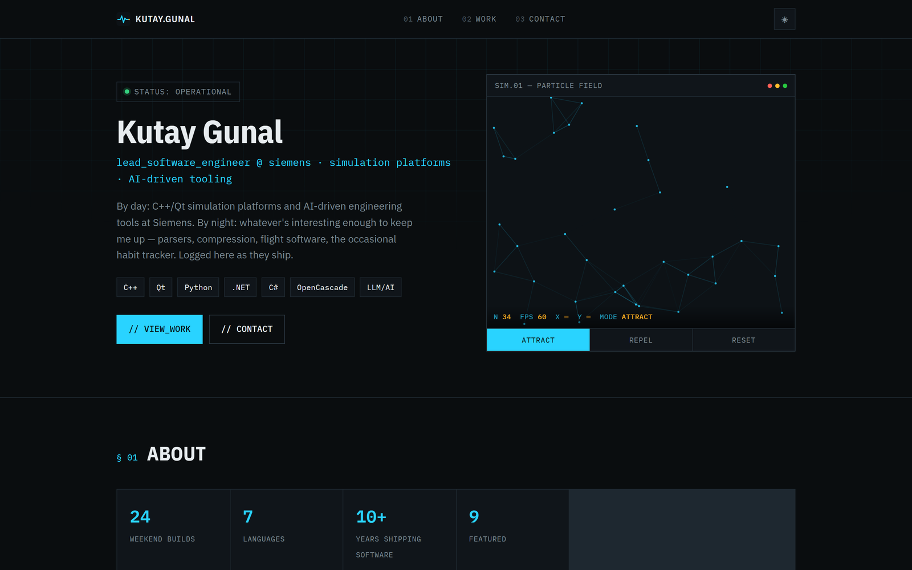
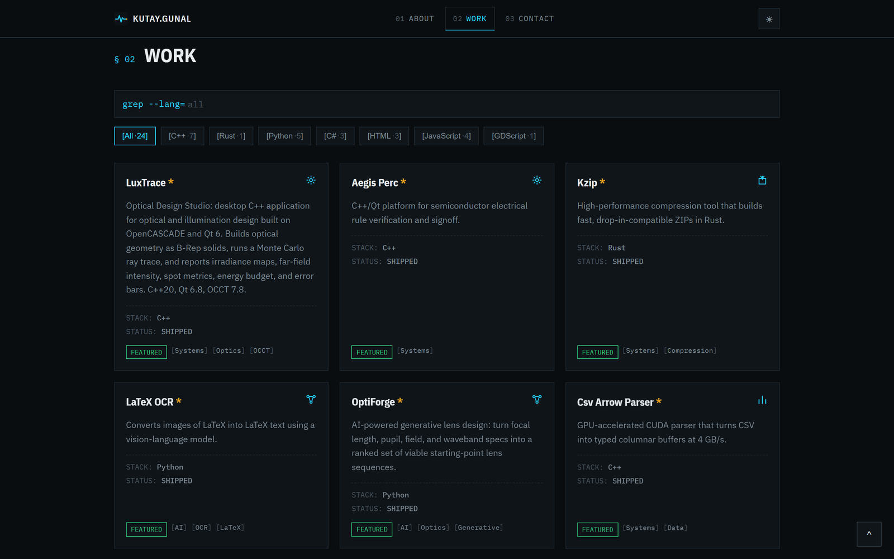
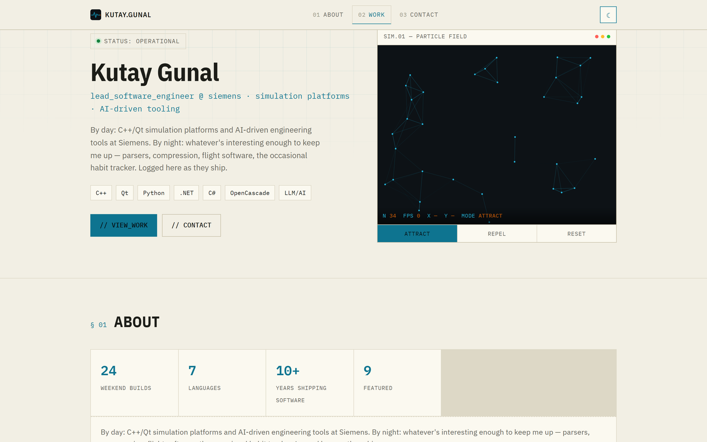
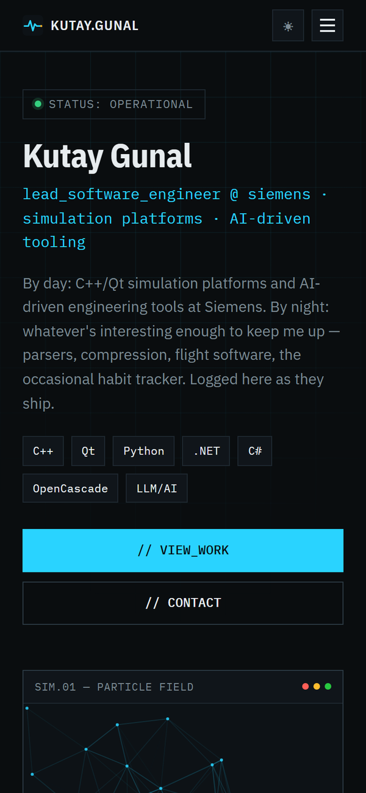

# kutay.work

Personal site and portfolio for **Kutay Gunal** — a themed, terminal-flavored build log that showcases weekend and side projects alongside day-job work. Live at **[kutay.work](https://kutay.work)**.



## Preview

| Work grid | Light mode | Mobile |
|---|---|---|
|  |  |  |

## Features

- **Data-driven project grid** — every card is generated from a single config file, with live search (`grep --lang=`) and language filter chips.
- **Dark / light theme toggle** — persisted per visitor, with a dedicated color system in CSS.
- **Interactive hero simulation** — a small canvas particle-field sim (attract/repel modes) rendered live in the hero panel.
- **Fully responsive** — tested from mobile (375px) up through desktop, with a collapsible mobile nav.
- **Zero build step** — static HTML/CSS/JS, deployable anywhere that serves files (currently GitHub Pages via a custom domain).
- **Embedded sub-project** — [C++ Interview Quest](cpp-interview-prep/), a gamified interview-prep app, served from its own route on the same domain.

## Tech stack

Vanilla HTML, CSS, and JavaScript — no framework, no bundler, no dependencies. Fonts load from Google Fonts (IBM Plex Mono / Sans); everything else is hand-rolled.

## Project structure

```
.
├── index.html              # Single-page site: hero, about, work, contact
├── css/style.css            # All styling, theme variables for dark/light
├── js/
│   ├── config.js             # Profile info + PROJECTS array (edit this to add work)
│   ├── app.js                 # Rendering, search/filter, nav, scroll effects
│   ├── sim.js                  # Hero particle-field simulation (canvas)
│   └── theme.js                 # Dark/light theme toggle + persistence
├── assets/                  # Favicons and README screenshots
├── cpp-interview-prep/      # Standalone sub-app served at /cpp-interview-prep/
├── dev_server.py            # No-cache local dev server
└── CNAME                    # GitHub Pages custom domain (kutay.work)
```

## Running locally

```bash
python dev_server.py        # serves on http://localhost:8000, no-cache for live editing
```

Any static file server works too (`npx serve`, VS Code Live Server, etc.) — `dev_server.py` just disables caching so edits show up on refresh without a hard reload.

## Adding a project

Add an entry to the `PROJECTS` array in [`js/config.js`](js/config.js):

```js
{
  name: "repo-name",          // GitHub repo name
  title: "Display Title",
  description: "One or two sentences on what it does and how it's built.",
  url: "https://github.com/kutaygunal/repo-name",
  language: "Python",
  tags: ["Tag1", "Tag2"],
  featured: true,              // optional — marks the card with a star
  status: "SHIPPED",
  category: "ai",              // drives the card icon — see CATEGORY_ICONS in js/app.js
},
```

Bump the `?v=` query string on the script/link tags in `index.html` after editing `config.js` or `style.css`, so GitHub Pages doesn't serve a stale cached copy.

## Deployment

Pushed straight to GitHub Pages via the `kutaygunal.github.io` repo, with `CNAME` pointing the custom domain `kutay.work` at it. No CI/build step — whatever is on `main` is what's live.

## License / contact

Personal project, not licensed for reuse. Reach out via [kutaygunal@outlook.com](mailto:kutaygunal@outlook.com) or [LinkedIn](https://www.linkedin.com/in/kutaygunal/).
